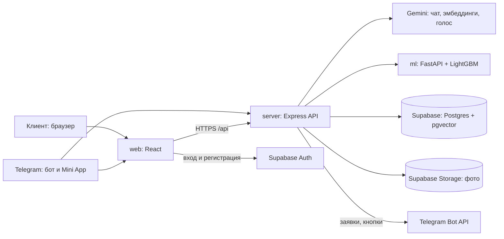
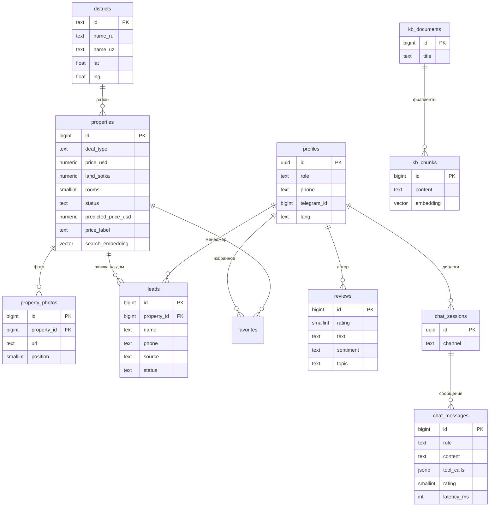
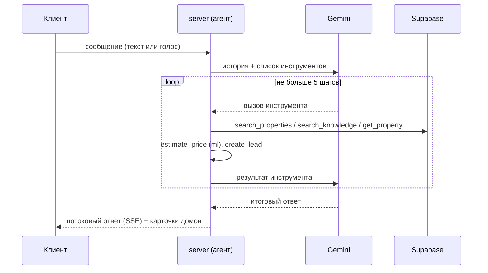

# Материалы для защиты диплома TashHome

**Опубликованный проект:**

- сайт: https://tash-home.vercel.app (админка: https://tash-home.vercel.app/admin/login);
- Telegram-бот и Mini App: [@tashhomeebot](https://t.me/tashhomeebot);
- API: https://tashhome-api.onrender.com/api/health.

Бесплатный Render засыпает без запросов: перед показом откройте сайт за 2–3 минуты.

Схемы написаны на Mermaid: они отображаются прямо на GitHub. Для презентации можно открыть https://mermaid.live, вставить код и сохранить картинку.

## 1. Соответствие заданию

| Требование | Что сделано |
|---|---|
| Многостраничный сайт | Главная, каталог, страница дома, ассистент, оценка дома, ипотека, сравнение, избранное, отзывы, вход и регистрация, личный кабинет, админка |
| Админ-панель: аналитика | Заявки по дням и источникам, дома по статусам, качество ассистента, тональность отзывов |
| Админ-панель: менять контент | Дома (текст, цена, фото), тексты главной (ru/uz), база знаний, статусы заявок, отзывы |
| Telegram-бот с обратной связью | Подбор домов, заявка в группу менеджеров с кнопками, ответ менеджера клиенту в чате |
| Telegram Mini App | Сайт внутри Telegram, вход по подписи initData |
| Оплата (необязательно) | Не делалась по решению автора |
| Бренд | Логотип: объёмная телебашня с флагом (`brand/`), он же значок сайта и аватарка бота |
| ИИ-часть | Ассистент с вызовом инструментов, RAG, голос, модель оценки цены, анализ отзывов |
| Оформление (сверх задания) | Вступление с видом Ташкента и флагом, 3D-телебашня на всех страницах, 3D-базар Чорсу, «ковёр» из фото домов, 3D-дом, который строится при прокрутке |

## 2. Архитектура

Размещение: сайт на Vercel, API и сервис оценки на Render, база и файлы в Supabase.

## 3. База данных

Дополнительно: `favorites`, `mortgage_programs`, `currency_rates`, `site_texts` (тексты главной), `bot_users` и `bot_threads` (переписка бота с менеджерами). Миграции: `supabase/migrations/0001–0007`.

## 4. Как работает ассистент

- Всё, что модель присылает в инструменты, проверяется схемами Zod; источник заявки определяет сервер.
- База знаний: 7 документов, 21 фрагмент, поиск по смыслу (pgvector, порог 0,65).
- Если основная модель перегружена, запрос повторяется на запасной.

## 5. Модель оценки цены

Данные синтетические (3000 домов; происхождение описано в `ml/data/README.md`). Признаки: район, площадь дома и участка, комнаты, этажность, материал, ремонт, год.

| Модель | MAE | MAPE | R² | В пределах ±10 % | В пределах ±20 % |
|---|---|---|---|---|---|
| Линейная регрессия (базовая) | $12 887 | 10,9 % | 0,828 | 58,2 % | 87,0 % |
| **LightGBM** | **$12 001** | **10,2 %** | **0,854** | 58,8 % | 89,2 % |

- Цель (MAPE не больше 15 %) выполнена, кросс-валидация подтверждает (10,1 %).
- Диапазон цены 80 % накрывает 78,3 % настоящих цен.
- Сильнее всего влияют площадь дома (37 %), район (25 %), участок (15 %).
- Честная оговорка: данные синтетические с шумом около ±10 %, поэтому ошибка около 10 % близка к пределу. На реальных объявлениях цифры будут другими.
- Графики: `ml/reports/eda/` и `ml/reports/model/`.

## 6. Оценка ассистента

Набор: 30 запросов на подбор домов (русский и узбекский) и 20 вопросов к базе знаний. Запуск: `npm run eval`.

| Показатель | До правки инструкции | После |
|---|---|---|
| Подбор домов верно | 29 из 30 (96,7 %) | **30 из 30 (100 %)** |
| База знаний, полностью верно | 85 % | **95 %** |
| Честный отказ вне темы | 75 % | **100 %** |
| Выдуманные ответы | 1 | **0** |
| Среднее время ответа на подбор | 42 с | **10 с** |

Метод: подбор проверяется по каталогу (показанные дома должны подходить под запрос, при отсутствии подходящих дома не показываются); ответы по базе знаний оценивает языковая модель по ожидаемым пунктам. Оговорка: результаты слегка меняются от прогона к прогону. Подробности: `server/eval/results/latest.md`.

## 7. Качество и безопасность

- 198 тестов сервера плюс тесты сервиса оценки цены; в тестах пойманы реальные ошибки (редактирование цены стирало статус и фото; поиск пропускал инъекцию условий в фильтр).
- Lighthouse (мобильный, опубликованный сайт, 2026-11-25): доступность, практики и SEO по 100; скорость каталога 93, главной 52 (вступление, «ковёр» из фото и 3D-графика).
- Роли и права на строки в базе, проверка картинок по содержимому, проверка подписи Mini App, ключи только в `.env`.

## 8. Что не доделано (говорить честно)

- Подтверждение почты при регистрации отключено, восстановления пароля нет; сравнение хранится только в браузере.
- Кнопки 👍/👎 под ответами ассистента не сделаны, поэтому в панели качества оценки пока «—».
- Скорость главной страницы на телефоне низкая (52) из-за 3D-оформления.
- Фото в «ковре» главной и 3D-картины из админки не меняются: меняются дома, их фото и тексты главной.
- Данные для модели цены синтетические; фото домов демонстрационные.
- Фото части домов добавлены автором: право на их публикацию нужно подтвердить (`web/public/houses/CREDITS.md`); у некоторых домов фото не совпадает с этажностью из описания.

Проверено вживую на опубликованной версии: Mini App открывается в Telegram, заявка из него приходит в группу менеджеров, статус меняется кнопкой и виден в админке, работают голосовой запрос, узбекский язык, ипотека и оценка дома на телефоне.

## 9. Сценарий демо (5–7 минут)

1. Каталог: фильтры, карточка с меткой «ниже рынка».
2. Ассистент: «Подбери дом в Мирзо-Улугбеке до 200 тысяч с участком от 5 соток», затем вопрос про документы продавца, затем запись на просмотр.
3. В Telegram менеджеру приходит заявка с кнопками; ответ менеджера доходит клиенту.
4. Голосовой запрос ассистенту.
5. Оценка цены своего дома.
6. Админка: статистика, редактирование текста главной, база знаний, отзывы с тональностью.
7. Показать результаты оценки ассистента и метрики модели (разделы 5 и 6).

Перед показом: открыть опубликованный сайт за 2–3 минуты (сервер и ml-сервис просыпаются), проверить интернет и что бот отвечает. Локально сервер с токеном бота не запускать: он перехватит бота у опубликованного.

## 10. Вопросы, которые могут задать

- **Почему синтетические данные?** Реальной выгрузки объявлений нет; генератор воспроизводит зависимости рынка, модель переобучается на реальных данных той же командой.
- **Что если Gemini недоступен?** Запасная модель, затем понятное сообщение; каталог, фильтры и заявки работают без ИИ.
- **Как защищены ключи?** Только в `.env` и в панелях сервисов, в git не попадают; секретный ключ базы только на сервере.
- **Как проверили качество ассистента?** Набор из 50 вопросов с автоматической проверкой, раздел 6.
